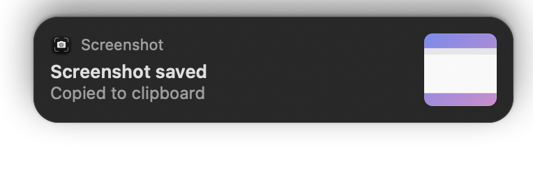
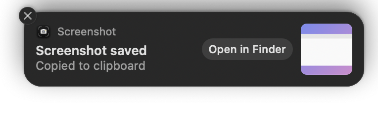

# BetterScreenshot

> This isn't an official tool. It's just a personal tool I made to take screenshots more easily. It isn't properly maintained or anything fancy, it's just for convenience and ease of use. Enjoy!

Press **Option + Shift + S**, drag over what you want, and that's it. The screenshot is saved as a PNG **and** copied to your clipboard so you can paste it anywhere right away.

<p align="center">
  
  
</p>

## What it does

- **One hotkey:** Option + Shift + S opens the normal macOS selection crosshair.
- **Saves automatically** to `~/Pictures/Screenshots` with a timestamped name like `Screenshot_2026-10-12_02-56-01.png`.
- **Copies to your clipboard** at the same time.
- **Shows a small notification** in the top-right corner with a thumbnail of your screenshot. Hover over it to see an **Open in Finder** button and a close (X) button.
- **No shutter sound** by default.
- Follows your **light/dark mode**, and respects **Reduce Motion** and **Reduce Transparency**.
- Pressing **Esc** cancels: nothing is saved or copied.

## Requirements

- **macOS**
- **[Homebrew](https://brew.sh)**, which the installer uses to install Hammerspoon
- **[Hammerspoon](https://www.hammerspoon.org)**, a free macOS automation app (installed for you by the script)

## Install

Open Terminal and run:

```bash
git clone https://github.com/MajdKZ1/BetterScreenshot.git
cd BetterScreenshot
./install.sh
```

The installer:

1. Checks that Homebrew is installed.
2. Installs Hammerspoon if you don't have it yet.
3. Creates `~/Pictures/Screenshots`.
4. Copies `betterscreenshot.lua` into `~/.hammerspoon/`.
5. Adds one line, `require("betterscreenshot")`, to `~/.hammerspoon/init.lua`. If you already have an `init.lua`, it's backed up first and your existing config is kept.
6. Starts Hammerspoon.

### Give Hammerspoon permission (required)

macOS needs you to allow two things the first time:

1. **System Settings → Privacy & Security → Screen & System Audio Recording**: turn on **Hammerspoon**.
2. **System Settings → Privacy & Security → Accessibility**: turn on **Hammerspoon**.

Then **quit Hammerspoon and open it again** (click the hammer icon in the menu bar → Quit, then open it from Applications). The permissions only take effect after a restart.

## Keybinds

| Where | Key / action | What it does |
|---|---|---|
| Anywhere | **Option + Shift + S** | Take a screenshot |
| Selecting | **Drag** | Select an area |
| Selecting | **Space** | Switch to capturing a whole window |
| Selecting | **Esc** | Cancel (nothing is saved) |
| Notification | **Hover** | Shows the buttons and keeps the notification open |
| Notification | **Open in Finder** | Shows the file in Finder |
| Notification | **X** (top-left) | Closes the notification |
| Notification | **Click anywhere else** | Closes the notification |

## Customize

All settings are at the top of `~/.hammerspoon/betterscreenshot.lua`. Open it in any text editor, change a value, then click the **Hammerspoon menu bar icon → Reload Config**.

| What | Setting | Example |
|---|---|---|
| Save folder | `screenshotDir` | `os.getenv("HOME") .. "/Desktop"` |
| Hotkey modifiers | `screenshotMods` | `{ "cmd", "shift" }` (options: `"cmd"`, `"alt"`, `"ctrl"`, `"shift"`) |
| Hotkey key | `screenshotKey` | `"x"` |
| Shutter sound | `playSound` | `true` |
| Launch at login | `launchAtLogin` | `false` |
| How long the notification stays | `stayTime` | `4` (seconds) |

> If you run `./install.sh` again later, your edited file is backed up as `betterscreenshot.lua.bak-<date>` before being replaced.

## Manual install (without the script)

1. Install Hammerspoon: `brew install --cask hammerspoon`
2. Copy `betterscreenshot.lua` into `~/.hammerspoon/` (create the folder if needed).
3. Add this line to `~/.hammerspoon/init.lua` (create the file if it doesn't exist):
   ```lua
   require("betterscreenshot")
   ```
4. Open Hammerspoon, give it the permissions above, and restart it.

## Uninstall

From the `BetterScreenshot` folder:

```bash
./uninstall.sh
```

This removes the `require` line from your `init.lua` (after backing it up) and deletes `~/.hammerspoon/betterscreenshot.lua`. Your screenshots are **not** deleted.

To remove Hammerspoon as well:

```bash
brew uninstall --cask hammerspoon
```

## Troubleshooting

- **Screenshots only show my wallpaper.** Hammerspoon is missing the **Screen Recording** permission. Turn it on (see above) and restart Hammerspoon.
- **Nothing happens when I press the hotkey.** Make sure Hammerspoon is running (hammer icon in the menu bar) and has the **Accessibility** permission, then restart it.
- **The hotkey does something else in one app.** Hammerspoon's hotkey takes over Option + Shift + S everywhere. Pick a different combo with `screenshotMods` / `screenshotKey`.
- **Option + Shift + S types `Í`.** That's what the key types when Hammerspoon isn't running or the config didn't load. Open Hammerspoon and click **Reload Config**; check the Hammerspoon Console for errors.

## License

[MIT](LICENSE). Do whatever you want with it, no warranty.
