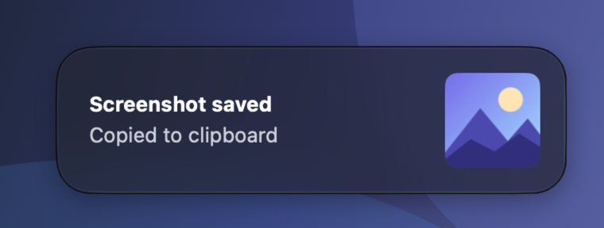
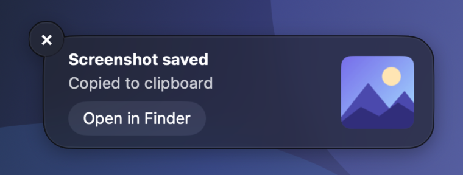

# BetterScreenshot

> This isn't an official tool. It's just a personal tool I made to take screenshots more easily. It isn't properly maintained or anything fancy, it's just for convenience and ease of use. Enjoy!

> [!NOTE]
> **Dynamic Island support is in beta and still under development.** It’s off by default on `main`. For the original screenshot experience without the integration, [install the `no-dynamic-island` branch](#install-without-dynamic-island).

Press **Option + Shift + S**, drag over what you want, and that's it. The screenshot is saved as a PNG **and** copied to your clipboard so you can paste it anywhere right away.

<p align="center">
  
  
</p>

## What it does

- **One hotkey:** Option + Shift + S opens the normal macOS selection crosshair.
- **Saves automatically** to `~/Pictures/Screenshots` with a timestamped name like `Screenshot_2026-10-12_02-56-01.png`.
- **Copies to your clipboard** at the same time.
- **Shows a small notification** in the top-right corner with a thumbnail of your screenshot. Hover over it to see an **Open in Finder** button and a close (X) button.
- **Uses native Liquid Glass on macOS 26 or later** when the notification helper is installed. The banner uses the macOS system font and standard control sizes.
- **No shutter sound** by default.
- Follows your **light/dark mode**, and respects **Reduce Motion** and **Reduce Transparency**.
- Pressing **Esc** cancels: nothing is saved or copied.

## Requirements

- **macOS**
- **[Homebrew](https://brew.sh)**, which the installer uses to install Hammerspoon
- **[Hammerspoon](https://www.hammerspoon.org)**, a free macOS automation app (installed for you by the script)
- **Xcode Command Line Tools with the macOS 26 SDK or later** for Liquid Glass. Run `xcode-select --install` if needed. The standard Hammerspoon notification is available without the helper.

## Install

Open Terminal and run:

```bash
git clone https://github.com/MajdKZ1/BetterScreenshot.git
cd BetterScreenshot
./install.sh
```

The installer:

1. Checks that Homebrew is installed.
2. Installs Hammerspoon if you don't have it yet.
3. Creates `~/Pictures/Screenshots`.
4. Copies `betterscreenshot.lua` into `~/.hammerspoon/`.
5. Builds and installs the Liquid Glass notification helper on supported Macs.
6. Adds one line, `require("betterscreenshot")`, to `~/.hammerspoon/init.lua`. If you already have an `init.lua`, it's backed up first and your existing config is kept.
7. Starts Hammerspoon.

### Install without Dynamic Island

Use the [`no-dynamic-island`](https://github.com/MajdKZ1/BetterScreenshot/tree/no-dynamic-island) branch for the original screenshot hotkey, clipboard copy, and notification toast.

```bash
git clone --branch no-dynamic-island --single-branch https://github.com/MajdKZ1/BetterScreenshot.git BetterScreenshot-no-dynamic-island
cd BetterScreenshot-no-dynamic-island
./install.sh
```

If you previously installed the BetterScreenshot beta plugin, disable or remove it in **DynamicLake Pro → Settings → Plugins** as well.

### Give Hammerspoon permission (required)

macOS needs you to allow two things the first time:

1. **System Settings → Privacy & Security → Screen & System Audio Recording**: turn on **Hammerspoon**.
2. **System Settings → Privacy & Security → Accessibility**: turn on **Hammerspoon**.

Then **quit Hammerspoon and open it again** (click the hammer icon in the menu bar → Quit, then open it from Applications). The permissions only take effect after a restart.

## Keybinds

| Where | Key / action | What it does |
|---|---|---|
| Anywhere | **Option + Shift + S** | Take a screenshot |
| Selecting | **Drag** | Select an area |
| Selecting | **Space** | Switch to capturing a whole window |
| Selecting | **Esc** | Cancel (nothing is saved) |
| Notification | **Hover** | Shows the buttons and keeps the notification open |
| Notification | **Open in Finder** | Shows the file in Finder |
| Notification | **X** (upper-left corner) | Closes the notification |
| Notification | **Click the banner** | Closes the notification |

## Customize

All settings are at the top of `~/.hammerspoon/betterscreenshot.lua`. Open it in any text editor, change a value, then click the **Hammerspoon menu bar icon → Reload Config**.

| What | Setting | Example |
|---|---|---|
| Save folder | `screenshotDir` | `os.getenv("HOME") .. "/Desktop"` |
| Hotkey modifiers | `screenshotMods` | `{ "cmd", "shift" }` (options: `"cmd"`, `"alt"`, `"ctrl"`, `"shift"`) |
| Hotkey key | `screenshotKey` | `"x"` |
| Shutter sound | `playSound` | `true` |
| Launch at login | `launchAtLogin` | `false` |
| How long the notification stays | `stayTime` | `4` (seconds) |
| Preview in DynamicLake (beta) | `dynamicLakePreview` | `false` by default. Set to `true` to opt in. |

> If you run `./install.sh` again later, your edited file is backed up as `betterscreenshot.lua.bak-<date>` before being replaced.

## Dynamic Island beta for DynamicLake Pro

This optional integration is still under development. The plugin appears as **BetterScreenshot (Beta)** in DynamicLake Pro.

BetterScreenshot shows a single thumbnail in the compact Dynamic Island for about three seconds. Captures are copied to the macOS clipboard automatically. Click the preview to show up to two recent screenshots in the same row, then click either image to copy its original PNG. Thumbnails are generated in memory from your configured screenshot folder.

For older captures, open **DynaGlance** and select the **camera** icon in its bottom navigation pill. The tab is available while the plugin is enabled, even when no capture is active.

### Build and install

1. Install or update the BetterScreenshot Hammerspoon module. If your Hammerspoon setup already contains an older inline screenshot implementation, migrate that hotkey to the module before reloading.
2. Build the local plugin package on the Mac where you’ll use it. This requires the Xcode Command Line Tools (`xcode-select --install`).

   ```bash
   ./dynamiclake/package.sh
   ```

3. In **DynamicLake Pro → Settings → Plugins → Install Local**, select `build/BetterScreenshot.dynamiclakeplugin`. Enable the plugin and allow action callbacks in its plugin settings so the thumbnails are clickable.
4. In `~/.hammerspoon/betterscreenshot.lua`, set `dynamicLakePreview = true` and reload Hammerspoon. For a custom save folder, set `screenshotDir` to its absolute path in the same file. Reloading shares that folder with the plugin before the first capture. Without a shared folder setting, the plugin uses `~/Pictures/Screenshots`.
5. Click the preview while it is visible to show recent screenshots. Press **Option + Shift + H** to show them after the preview dismisses. Change `dynamicLakeHistoryMods` and `dynamicLakeHistoryKey` in the Lua module if that shortcut conflicts with another app.

### Verify and troubleshoot

- Take a screenshot with **Option + Shift + S**. The thumbnail appears in a single row and dismisses after about three seconds. If you take another screenshot while it is visible, the thumbnail updates in place. Press **Esc** during capture to verify that canceling adds no entry or preview.
- Open recent screenshots and click a thumbnail to copy its original PNG. The latest is on the left and the previous one is on the right. The row closes after you select an image.
- In the DynaGlance camera tab, scroll through a page and use the arrows to browse older or newer pages. Click a thumbnail or the copy icon to copy its image. The folder icon reveals the original PNG in Finder. Both actions are also available by right-clicking a row.
- **Clear History** (**Clear** in DynaGlance) hides existing screenshots from the history and compact recents for that save folder. The original PNGs stay on disk, and new captures appear normally after a restart.
- Expand DynaGlance's right pane for the full Screenshot History Lake, or select **BetterScreenshot (Beta)** under **Plugins** in DynamicLake’s **Left Click Lake**, **Right Click Lake**, or **On Hover Behavior** settings.
- DynamicLake’s activity priority and visibility settings determine what appears in the island. The Hammerspoon toast is skipped when DynamicLake accepts the Live Activity. If it does not acknowledge the request within one second, Hammerspoon shows its usual toast. Set `dynamicLakePreview = false` and reload Hammerspoon for an immediate toast every time.
- DynamicLake Pro 2.2.2 renders up to two images in its compact activity. The capture preview stays in that row. The DynaGlance tab and full Lake require the host’s `lake` and `lakeLayout` features.
- The plugin uses your local screenshot folder and needs no DynamicLake plugin permission declarations. If your custom folder is unavailable to the plugin, check that DynamicLake can read it. Your existing Hammerspoon permissions still govern capture.

Use `python3 dynamiclake/test_protocol.py` after building to run the local protocol tests. The package uses DynamicLake’s [JSON Plugin API](https://docs.dynamiclake.com/documentation/dynamiclakekit/jsonpluginapi/) and [Lakes API](https://docs.dynamiclake.com/documentation/dynamiclakekit/lakes/).

## Manual install (without the script)

1. Install Hammerspoon: `brew install --cask hammerspoon`
2. Copy `betterscreenshot.lua` into `~/.hammerspoon/` (create the folder if needed).
3. Add this line to `~/.hammerspoon/init.lua` (create the file if it doesn't exist):
   ```lua
   require("betterscreenshot")
   ```
4. Open Hammerspoon, give it the permissions above, and restart it.

To add Liquid Glass to a manual installation on macOS 26 or later, build the helper from the repository:

```bash
xcrun --sdk macosx swiftc -O -target "$(uname -m)-apple-macosx26.0" \
  notification/BetterScreenshotToast.swift -o "$HOME/.hammerspoon/betterscreenshot-toast"
```

## Uninstall

From the `BetterScreenshot` folder:

```bash
./uninstall.sh
```

This removes the `require` line from your `init.lua` (after backing it up), the BetterScreenshot module, and the Liquid Glass notification helper. Your screenshots are **not** deleted.

If you installed the optional DynamicLake plugin, you can disable or remove it separately in **DynamicLake → Settings → Plugins**.

To remove Hammerspoon as well:

```bash
brew uninstall --cask hammerspoon
```

## Troubleshooting

- **Screenshots only show my wallpaper.** Hammerspoon is missing the **Screen Recording** permission. Turn it on (see above) and restart Hammerspoon.
- **Nothing happens when I press the hotkey.** Make sure Hammerspoon is running (hammer icon in the menu bar) and has the **Accessibility** permission, then restart it.
- **The hotkey does something else in one app.** Hammerspoon's hotkey takes over Option + Shift + S everywhere. Pick a different combo with `screenshotMods` / `screenshotKey`.
- **Option + Shift + S types `Í`.** That's what the key types when Hammerspoon isn't running or the config didn't load. Open Hammerspoon and click **Reload Config**; check the Hammerspoon Console for errors.

## License

[MIT](LICENSE). Do whatever you want with it, no warranty.
